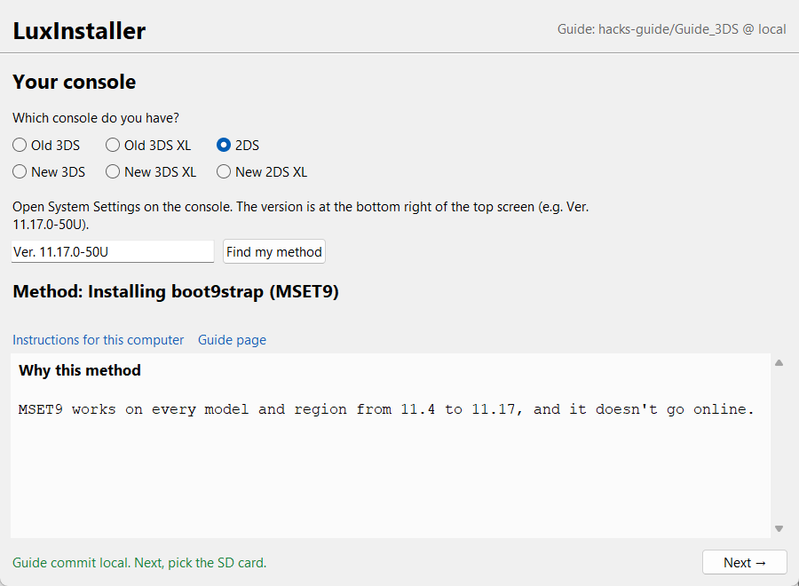
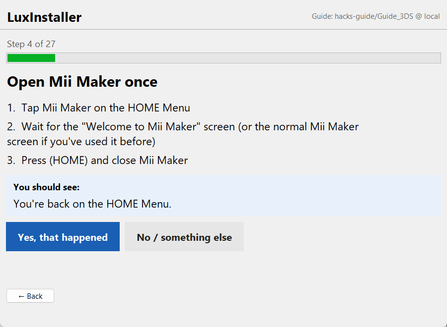
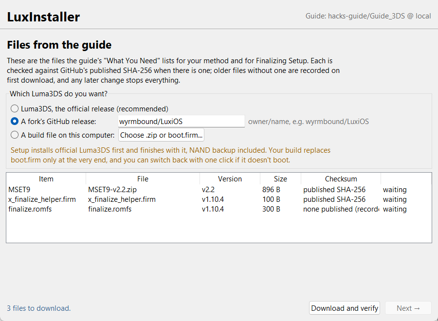

<p align="center">
  
</p>

<h1 align="center">LuxInstaller</h1>

<p align="center">
  <b>A guided 3DS custom firmware installer.</b> Type your system version, pick your SD card, and LuxInstaller
  prepares the card, runs MSET9 for you, and walks you through every button press on the console
  to install <b>boot9strap + Luma3DS</b> (or a fork like <a href="https://github.com/wyrmbound/LuxiOS">LuxiOS</a>).
</p>

<p align="center">
  <a href="https://github.com/wyrmbound/LuxInstaller/releases/latest"></a>
  
  
</p>

LuxInstaller follows [3ds.hacks.guide](https://3ds.hacks.guide), the community guide for Nintendo 3DS
homebrew, and does the PC side of it for you. You don't copy files by hand, install Python, or read
pages of instructions. Every console step is one small screen: *press these buttons → this should
happen → did it?* LuxInstaller checks the SD card between steps and won't move on until it looks right.

**Works with:** Old 3DS, Old 3DS XL, 2DS, New 3DS, New 3DS XL and New 2DS XL on system versions
**11.4 to 11.17** (any region), using the MSET9 exploit. For older versions it follows the guide's own method choice.



## Contents

- [Download](#download)
- [How it works](#how-it-works)
- [Choose your Luma3DS: official or a fork](#choose-your-luma3ds-official-or-a-fork)
- [Safety](#safety)
- [FAQ](#faq)
- [Run from source](#run-from-source)
- [Status and known issues](#status-and-known-issues)
- [Credits and license](#credits-and-license)

## Download

**Windows:** download `LuxInstaller.exe` from the [latest release](https://github.com/wyrmbound/LuxInstaller/releases/latest)
and open it. It doesn't need installing and runs on x64 and ARM64 Windows 10/11.

Windows SmartScreen may warn that the app is unrecognized, because it isn't code-signed. Click
**More info → Run anyway**, or [run it from source](#run-from-source).

**macOS / Linux:** [run from source](#run-from-source). Drive detection on those systems has only
been tested against sample output so far.

You'll need:
- your 3DS/2DS and its SD card (FAT32; LuxInstaller checks it),
- an SD card reader on your computer,
- about an hour.

## How it works

1. **Your console.** Pick the model and type the version from System Settings (e.g. `11.17.0-50U`).
   LuxInstaller picks the method and tells you why.
2. **Your SD card.** Only removable drives are listed. LuxInstaller checks the format, cluster size and
   free space, then asks you to type the card's label before it writes anything.
3. **Downloads.** It fetches exactly the files the guide lists (MSET9, Luma3DS, the finalize script)
   from their official GitHub releases, and checks each against its published SHA-256.
4. **Baby steps.** About 27 small screens, each one either something LuxInstaller does on the PC or
   a few button presses on the console:

   

   On the PC side it copies the files, runs the official `mset9.py` for you (no Python install
   needed), and checks that boot9strap is installed and MSET9 is cleanly removed. If a screen
   doesn't match what you see, **No / something else** shows what to try and links the exact guide
   and troubleshooting page.
5. **Backups.** At the end your NAND backup and `essential.exefs` are copied to your computer
   (`~/3DS-Backups/`), checked against their checksums, and listed in a `MANIFEST.json`.

If you close the app, it remembers where you were and picks up from that step.

## Choose your Luma3DS: official or a fork

On the downloads page you choose which Luma3DS you end up with:



- **Luma3DS, the official release.** This is the recommended choice.
- **A fork's GitHub release.** Enter `owner/name`, for example `wyrmbound/LuxiOS`. LuxInstaller takes
  the latest stable release, or the newest pre-release if there's no stable one yet. It uses the
  release's `boot.firm` and checks it against GitHub's published checksum.
- **A build file on this computer.** A `.zip` or a `boot.firm` you built yourself.

The setup always runs with official Luma3DS, because that's what the guide's steps are written for.
Your chosen build replaces `boot.firm` only at the very end, after the NAND backup. If it doesn't
boot, the last page has a **Put official Luma3DS back** button.

## Safety

- **Never writes to a drive you didn't confirm.** You type the drive's label first. System drives are
  never listed, and writes stop if a different card is put in.
- **Never formats or deletes from your card.** If the card isn't set up right, LuxInstaller links the
  guide's formatting page.
- **Only official, checked files.** Downloads use HTTPS from GitHub only, every file is checked by
  SHA-256, and any mismatch stops everything. Every file copied to the card is read back and compared.
- **Your `Nintendo 3DS` folder:** LuxInstaller doesn't write there itself. Two things change it,
  both following the guide:
  - the official MSET9 script, run unmodified;
  - one rename from the guide's manual-removal steps, used only if the script leaves your data folder
    named `…_user-id1`. It never overwrites a folder.
- **No piracy tools.** LuxInstaller doesn't download or link title installers, ticket dumps or CIA sources.
- **A full record.** Every SD write is logged with its SHA-256 in `~/.3ds-assistant/logs/`.

## FAQ

**Does it work on 11.17.0-50U / 50E / 50J?**
Yes. MSET9 covers 11.4 to 11.17 on every model and region, without going online.

**I accidentally updated my console. Can I still use this?**
Yes, as long as it's on 11.4 to 11.17. That's why LuxInstaller defaults to MSET9: some older methods
have a step that can update the console.

**Will I lose my games or saves?**
No. During MSET9 your games disappear from the HOME Menu for a while. That's expected: MSET9 sets your
data folder aside, and LuxInstaller checks it's back in place before you continue.

**Is this official?**
No. LuxInstaller is an independent project. It isn't affiliated with Nintendo, Nintendo Homebrew,
or the authors of 3ds.hacks.guide, MSET9 or Luma3DS. It runs their published tools and follows
their guide.

**Can it brick my console?**
Installing custom firmware always carries some risk. LuxInstaller only follows the guide's steps,
checks the card between them, and makes and verifies a NAND backup, which is what recovers a console
if something goes wrong. Keep a second copy of that backup somewhere safe.

**My console already has Luma3DS. Can it update it?**
Yes. If the card already has `luma/` and `boot.firm`, LuxInstaller follows the guide's
"Checking for CFW" steps and offers the Luma3DS and GodMode9 updates.

## Run from source

Requires Python 3.12.

```bash
git clone https://github.com/wyrmbound/LuxInstaller
cd LuxInstaller
python -m venv .venv
.venv/Scripts/python -m pip install -e .[dev]     # macOS/Linux: .venv/bin/python
luxinstaller                                       # desktop window
```

| Command | What it does |
|---|---|
| `luxinstaller` | Desktop window (the default) |
| `luxinstaller --tui` | Terminal UI (Textual) |
| `luxinstaller --no-tui` | Plain command-line flow |
| `--dry-run` | Show what would be copied to the card without writing |
| `--backup-dir DIR` | Where backups go (default `~/3DS-Backups`) |
| `--guide-dir DIR` | Use a local [Guide_3DS](https://github.com/hacks-guide/Guide_3DS) checkout instead of GitHub |
| `--restart` | Ignore saved progress |

**Windows on ARM64:** the `quickjs` package has no ARM64 wheel. Create the venv with x64 Python 3.12
(`winget install --id Python.Python.3.12 --architecture x64`, then `py -V:3.12 -m venv .venv`).

Set `GITHUB_TOKEN` to raise the GitHub API rate limit. It's sent only to `api.github.com`.

**Tests:** run `.venv/Scripts/python -m pytest -q`. The tests mock the network, use folders as fake
SD cards, simulate the console, and run the real MSET9 script on a fake card.

**Executables:** run `.venv/Scripts/python scripts/build_exe.py`. It builds `dist/LuxInstaller.exe`
(windowed) and `dist/luxinstaller-cli.exe` (console). Run `scripts/make_icon.py` to regenerate the
icon from `assets/luxinstaller.svg`.

### How the method is picked

LuxInstaller doesn't hard-code exploit logic. It downloads and parses
[hacks-guide/Guide_3DS](https://github.com/hacks-guide/Guide_3DS), and runs the guide's own
`selecting.js` in a sandboxed QuickJS engine to see which page the guide would send you to. For
11.4 to 11.17 it uses MSET9 (the method that works everywhere); otherwise it uses the guide's choice.
On launch it checks whether the guide has changed, and warns when the pages behind the walkthrough
no longer match what the steps were written from.

## Status and known issues

- **Tested on real hardware:** one complete install on an Old 2DS (11.17.0-50U) from Windows 11,
  October 2026, including the MSET9 run, the NAND backup and a LuxiOS install.
- **MSET9 bug:** while testing, we found a bug in the official MSET9 v2.2 script: it skips renaming
  your data folder back when it's run without a console. LuxInstaller works around it (see
  [the report upstream](https://github.com/hacks-guide/MSET9/issues)).
- **Not finished yet:**
  - macOS and Linux drive listing is untested on real machines;
  - the SD card read/write test (like h2testw) isn't offered in the app yet.

Found a problem? [Open an issue](https://github.com/wyrmbound/LuxInstaller/issues) with a screenshot
of the step you're on.

## Credits and license

- [3ds.hacks.guide](https://3ds.hacks.guide) / [Guide_3DS](https://github.com/hacks-guide/Guide_3DS)
  by Nintendo Homebrew (MIT). Test fixtures include an excerpt with its license.
- [MSET9](https://github.com/hacks-guide/MSET9), [Luma3DS](https://github.com/LumaTeam/Luma3DS),
  [boot9strap](https://github.com/SciresM/boot9strap), [GodMode9](https://github.com/d0k3/GodMode9) and
  the finalize script. LuxInstaller downloads these from their own releases; none are bundled.
- The icon features Luxi, the original mascot of [LuxiOS](https://github.com/wyrmbound/LuxiOS).
- Built with AI assistance (Claude) and tested on real hardware.

LuxInstaller is MIT-licensed (see [LICENSE](LICENSE)). Nintendo 3DS and Nintendo 2DS are trademarks of Nintendo.
